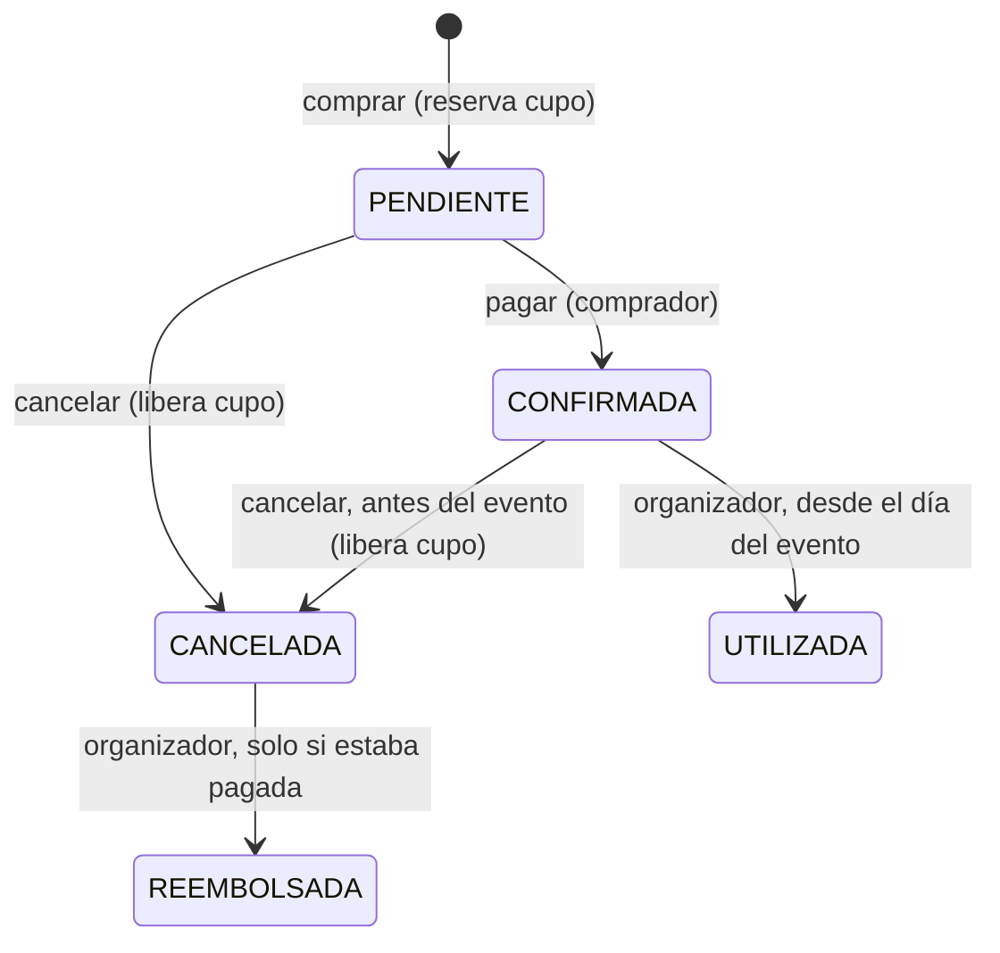

# AI Ticket It

Plataforma de venta de entradas para eventos (TP Individual DDSW 2C 2026). Enunciado en [consigna.md](consigna.md).

- **Backend:** Node.js + Express 5, persistencia en memoria, dominio con comportamiento (clases), tests con `node:test`.
- **Frontend:** React Native con Expo (JavaScript), React Navigation.

## Requisitos

- Node.js 20+
- Expo Go en el celular (opcional) o emulador Android/iOS, o un navegador (Expo web).

## Arranque

### Backend

```bash
cd backend
npm install
npm start        # API en http://localhost:3001
npm test         # tests de dominio + API (no necesita el server levantado)
npm run smoke    # recorrido E2E contra el server levantado
```

Variables opcionales: `JWT_SECRET`, `PORT`, `ENABLE_SEED_USERS`.

### Frontend

```bash
cd frontend
npm install
npm start        # y abrí con Expo Go, o tocá "w" para web
```

La URL del API se resuelve sola (`frontend/src/api/config.js`):

1. `EXPO_PUBLIC_API_URL` si está definida.
2. En Expo Go (celular físico o emulador) usa la IP de la PC que sirve el bundle → `http://<IP>:3001`. Celular y PC tienen que estar en la misma red Wi-Fi.
3. Fallback: `10.0.2.2` (emulador Android) o `localhost` (web / iOS simulator).

## Usuarios y escenarios de demo (seed)

| Email | Password | Roles |
| --- | --- | --- |
| ana@ticket.it | ana123 | COMPRADOR |
| luis@ticket.it | luis123 | ORGANIZADOR |
| maria@ticket.it | maria123 | COMPRADOR, ORGANIZADOR |

Las contraseñas se guardan hasheadas con bcrypt. El seed usa las mismas operaciones de dominio que la API, con un reloj simulado, y deja listos estos escenarios:

| Compra de Ana | Estado | Para mostrar |
| --- | --- | --- |
| Rock Night (en 20 días) | Confirmada, con chat | Días restantes, chat |
| Hamlet · Pullman | Pendiente de pago | Pagar / cancelar |
| Hamlet · Platea | Cancelada (pagada) | Luis la marca como **reembolsada** |
| Jazz al Atardecer (**hoy**) | Confirmada | Luis la marca como **utilizada** |
| Stand-up (pasado) | Utilizada, sin reseña | Ana deja una **reseña** |
| Maratón (pasado, de María) | Utilizada, con reseña | Puntaje del organizador |

Los datos viven en memoria: al reiniciar el backend se vuelve al estado inicial.

## Estados de una compra



Reglas (en `backend/src/domain/Compra.js`):

- Comprar reserva el cupo al crear la compra, así dos compras pendientes no pueden vender la misma entrada.
- Cancelar: comprador u organizador, si no está utilizada y el evento no se realizó.
- Reembolsar: es una acción del organizador para registrar que devolvió el dinero, solo para compras que se habían pagado.
- Reseñar: solo el comprador, con la compra utilizada, después del evento y una sola vez (puntaje entero de 1 a 5).
- Cada cambio de estado queda en el historial (`CambioEstadoCompra`: estado, quién y cuándo).
- El backend devuelve `acciones` por compra (`pagar`, `cancelar`, `utilizar`, `reembolsar`, `reseniar`), así la UI no duplica las reglas.

## Casos de uso

Los 12 casos de uso de la consigna, más estos propios:

13. Como **comprador**, quiero guardar eventos como favoritos y verlos filtrados en el catálogo.
14. Como **organizador**, quiero adjuntar imágenes (URLs) a mis eventos; como **comprador**, quiero verlas en el catálogo y en el detalle del evento.
15. Como **organizador**, quiero registrar cuándo reembolsé una compra cancelada.
16. Como **comprador**, quiero filtrar eventos por rango de precio (aparece si al menos un tipo de entrada está dentro del rango).
17. Como **comprador** u **organizador**, quiero ver el historial de estados de una compra.

## API

Todas las rutas (salvo login y seed-users) requieren `Authorization: Bearer <JWT>`. Los errores responden `{ "error": "mensaje" }` con su status HTTP.

| Método | Ruta | Rol | Descripción |
| --- | --- | --- | --- |
| POST | `/api/auth/login` | — | `{ email, password }` → `{ token, user }` |
| GET | `/api/auth/me` | — | Perfil (incluye ids de favoritos) |
| GET | `/api/auth/seed-users` | — | Usuarios demo (sin passwords; deshabilitado en producción) |
| GET | `/api/categorias` | — | |
| GET | `/api/eventos` | — | Filtros: `q`, `categoriaId`, `precioMin`, `precioMax`, `soloFavoritos`, `proximos`, `orden=precio\|fecha\|puntaje`, `dir=asc\|desc` |
| GET | `/api/eventos/:id` | — | Detalle + reseñas del organizador |
| POST | `/api/eventos` | ORGANIZADOR | Crear (fecha futura, tipos con precio > 0 y cupo entero, URLs http/https) |
| GET | `/api/eventos/mios` | ORGANIZADOR | |
| GET | `/api/eventos/:id/compras` | ORGANIZADOR (dueño) | Compras + estadísticas; filtro `estado` |
| GET/POST/DELETE | `/api/usuarios/me/favoritos[/:eventoId]` | — | Listar / agregar / quitar (idempotentes) |
| POST | `/api/compras` | COMPRADOR | `{ eventoId, tipoEntradaId, cantidad }` |
| GET | `/api/compras/mias` | — | |
| GET | `/api/compras/:id` | participante | Detalle + historial + acciones |
| POST | `/api/compras/:id/pagar` · `/cancelar` · `/utilizar` · `/reembolsar` | según regla | Comandos de dominio |
| GET/POST | `/api/compras/:id/mensajes` | participante | Chat |
| POST | `/api/compras/:id/resenia` | comprador | `{ puntuacion, detalle }` |
| GET | `/api/organizadores/me/resenias` | ORGANIZADOR | Reseñas recibidas |

## Estructura

```
backend/src/
  domain/        clases con comportamiento: Compra, Evento, TipoEntrada, Usuario, Resenia, Mensaje...
  repositories/  store en memoria + repositorios
  services/      casos de uso (orquestan dominio y repositorios)
  presenters/    dominio → JSON (sin passwords ni referencias circulares)
  controllers/   HTTP fino, sin try/catch (Express 5 + AppError)
  errors/        AppError y helpers (badRequest, notFound...)
  middleware/    requireAuth, requireRole
backend/test/    node:test (dominio + API)
frontend/src/
  api/ context/ navigation/ screens/ components/ hooks/ utils/
```

## Accesibilidad y UX (frontend)

- Todos los controles tienen rol, nombre y estado accesibles (`selected`, `checked`, `disabled`, `busy`, `expanded`); los selectores de cantidad y las estrellas son "adjustable".
- Áreas táctiles de al menos 44×44. Paleta con contraste AA. Los estados se muestran con etiqueta e ícono, no solo con color.
- Encabezados semánticos; errores y confirmaciones anunciados al lector de pantalla; las tarjetas se leen como una sola frase.
- Diálogos multiplataforma (en web `Alert` con botones no funciona), validación inline en formularios, estados de carga, error con "Reintentar" y vacíos con una acción.
- Pull-to-refresh, chat con polling cada 5 s y auto-scroll, confirmación antes de acciones irreversibles, botones bloqueados mientras procesan (evita el doble envío).
