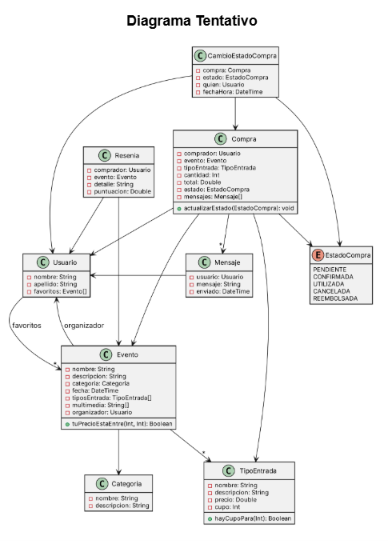
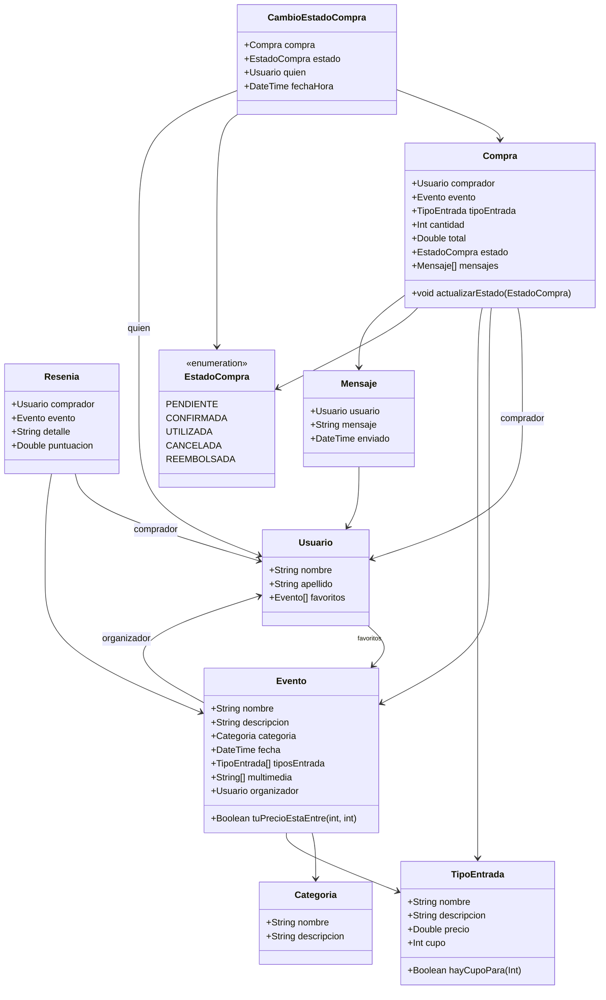

# AI Ticket It — Plataforma de Venta de Entradas para Eventos

> **Trabajo Práctico Individual**  
> Desarrollo con Inteligencia Artificial · 2C 2026

---

## Índice

1. [Objetivo del trabajo](#objetivo-del-trabajo)
2. [Contexto general](#contexto-general)
3. [Diagrama tentativo](#diagrama-tentativo)
4. [Requerimientos técnicos](#requerimientos-técnicos)
5. [Casos de uso](#casos-de-uso)
6. [Entrega](#entrega)

---

## Objetivo del trabajo

El objetivo de este trabajo práctico es brindar a los estudiantes un espacio de experimentación intensiva con herramientas de Inteligencia Artificial aplicadas al desarrollo de software.

Actualmente, el uso de IA se ha convertido en un factor clave para potenciar la productividad, acelerar ciclos de desarrollo y asistir en la resolución de problemas técnicos complejos.

Sin embargo, también resulta fundamental comprender las implicancias de depender excesivamente de estas herramientas sin un adecuado criterio técnico. Por este motivo, el presente trabajo propone explorar el uso de Inteligencia Artificial como herramienta principal de desarrollo, promoviendo su utilización de manera intensiva pero consciente.

En este trabajo se buscará que los estudiantes desarrollen una aplicación completa utilizando Inteligencia Artificial como principal apoyo durante todo el proceso de construcción. Se espera que los estudiantes se enfrenten al desafío de trabajar con tecnologías y herramientas que no hayan utilizado previamente, con el objetivo de fortalecer su capacidad de aprendizaje autónomo, adaptación tecnológica y resolución de problemas en contextos reales de desarrollo.

---

## Contexto general

Durante los últimos años, la industria del entretenimiento en vivo creció de forma sostenida: recitales, obras de teatro, festivales, conferencias y eventos deportivos convocan cada vez a más público. Cada vez más personas buscan descubrir eventos de su interés y adquirir entradas de forma rápida y segura desde su teléfono, sin necesidad de hacer filas en boleterías. En paralelo, miles de productores independientes, salas y organizadores eligen publicar sus propios eventos y gestionar la venta de entradas de manera autónoma.

En este contexto, surge la necesidad de plataformas que permitan conectar de manera simple y segura a quienes organizan eventos con quienes desean asistir:

- **Organizadores** requieren herramientas para publicar eventos, definir tipos de entrada (por ejemplo, General, Platea o VIP), establecer precios y cupos, y administrar las ventas.
- **Compradores** buscan explorar eventos por categoría, buscar espectáculos mediante una barra de búsqueda y comprar entradas de manera rápida y confiable.

Como respuesta a esta necesidad, una organización ha solicitado el desarrollo de **AI Ticket It**, una plataforma orientada a la publicación de eventos y la venta de entradas.

Dentro del sistema:

- Los **organizadores** podrán crear y gestionar eventos, incluyendo descripciones detalladas, fecha de realización, material multimedia y distintos tipos de entrada según ubicación, precio y cupo disponible.
- Los **compradores** podrán navegar el catálogo, filtrar por categorías, guardar favoritos y comprar las entradas que mejor se adapten a sus necesidades.

Una vez realizada una compra, el sistema permitirá realizar un seguimiento hasta el día del evento. Las compras atravesarán distintas etapas que reflejan su situación:

| Estado |
| --- |
| Pendiente de pago |
| Confirmada |
| Utilizada |
| Cancelada |
| Reembolsada |

Esto permite tanto al comprador como al organizador conocer el estado actual y realizar las acciones correspondientes en cada momento. Además, cada compra contará con un espacio de comunicación simple donde ambas partes podrán intercambiar mensajes para consultas sobre el evento, el acceso al lugar o eventuales cambios de fecha.

Una vez finalizado el evento, los asistentes podrán calificar su experiencia mediante un puntaje y un comentario, permitiendo que futuros compradores conozcan la reputación de cada organizador. La plataforma buscará brindar una experiencia clara, ordenada y transparente, facilitando la organización de los eventos y reduciendo la dependencia de canales externos de comunicación y venta.

Para llevar adelante este objetivo, se diseñará e implementará **AI Ticket It** como una solución web moderna y escalable. El desarrollo se organizará en distintas iteraciones, permitiendo construir progresivamente las funcionalidades principales del sistema, desde el modelo conceptual del negocio hasta la implementación completa de la plataforma.

---

## Diagrama tentativo

---

## Requerimientos técnicos

Para el desarrollo del trabajo práctico se espera la implementación de dos módulos principales:

| Módulo | Tecnología |
| --- | --- |
| **Back-End** | Node + Express |
| **Front-End** | React Native |

La aplicación deberá ejecutarse de forma local en un dispositivo *mobile* y utilizar un mecanismo de **persistencia en memoria** para el almacenamiento de datos.

### Herramientas recomendadas

A continuación se listan algunas herramientas recomendadas para asistir el desarrollo. **Su uso no es obligatorio.**

| Herramienta | Descripción |
| --- | --- |
| **Google Antigravity** | Útil para exploración de ideas, documentación, análisis de flujos y generación de contenido conceptual. |
| **Cline** | Agente de programación open source que se integra al editor (VS Code, JetBrains) o a la terminal, o mediante su app de escritorio. Trabaja en modos *Plan* y *Act*: primero acuerda una estrategia con el usuario y luego la ejecuta, creando y modificando archivos y ejecutando comandos con su aprobación. Permite elegir el proveedor de modelos, incluyendo modelos locales gratuitos. |
| **Claude** | Asistente conversacional y depurador de lógica. Muy útil para acelerar el desarrollo y explicar código, aunque limitado por un cupo de mensajes diario en su versión gratuita. |
| **Cursor** | Editor de código con IA integrada. Útil para generar, entender y modificar código directamente dentro del proyecto, especialmente en backend y lógica general. |
| **Visual Studio Code + GitHub Copilot** | Entorno de desarrollo + autocompletado inteligente. Muy útil para acelerar la escritura de código, especialmente en frontend y estructuras repetitivas. |
| **v0 (Vercel)** | Generador de interfaces a partir de prompts. Ideal para prototipar frontend. No genera aplicaciones completas; suele usarse para diseñar la UI y luego implementar la lógica real en el proyecto. |
| **Base44** | Plataforma de generación de aplicaciones mediante IA. Útil para generar estructuras visuales o flujos iniciales. Al igual que v0, es más útil como base o referencia visual que como código final completo. |

### Enfoque del trabajo

El objetivo de este trabajo es analizar el desarrollo de software potenciado mediante herramientas de inteligencia artificial, considerando tanto sus **ventajas** como sus **desventajas**.

> No se espera bajo ningún concepto la suscripción, compra o uso de herramientas pagas. El enfoque estará puesto en la comprensión de los conceptos, la capacidad de análisis y la correcta aplicación de las herramientas disponibles, por sobre la perfección absoluta de los resultados obtenidos.

Se valorará especialmente el criterio utilizado durante el proceso de desarrollo, la justificación de decisiones y la reflexión crítica sobre el uso de IA en el contexto planteado.

---

## Casos de uso

Se espera el desarrollo de las siguientes funcionalidades:

1. Como **comprador**, quiero poder visualizar mis compras, diferenciando con claridad el estado en el que se encuentran y cuántos días faltan para el evento en caso de estar en estado *confirmada*.
2. Como **organizador**, quiero poder visualizar las compras asociadas a un Evento en particular, diferenciando con claridad el estado en el que se encuentran y cuántas entradas quedan disponibles de cada tipo.
3. Como **comprador**, quiero poder buscar Eventos de forma específica mediante una búsqueda textual o explorarlos por categorías.
4. Como **organizador**, quiero poder crear un Evento ofreciendo distintos tipos de entrada, cada uno con su precio y cupo, permitiendo adaptarse a diferentes públicos y presupuestos.
5. Como **comprador**, quiero poder enviar mensajes en cualquier momento relacionados a una compra mediante un chat dentro de la misma.
6. Como **organizador**, quiero poder responder mensajes en cualquier momento relacionados a una compra mediante un chat dentro de la misma.
7. Como **comprador**, quiero poder cancelar una compra para obtener el reembolso en caso de no poder asistir al evento.
8. Como **organizador**, quiero que los compradores puedan cancelar una compra siempre que la misma no se encuentre en estado *utilizada* y el evento aún no se haya realizado.
9. Como **organizador**, quiero que una vez utilizada una entrada el comprador pueda puntuar el Evento de forma numérica y dejar un comentario escrito.
10. Como **comprador**, quiero que las reseñas de eventos anteriores se visualicen en los Eventos de cada organizador para conocer experiencias previas antes de comprar.
11. Como **comprador**, al buscar Eventos, quiero poder ordenarlos por precio, fecha del evento y puntaje del organizador.
12. Como **comprador**, quiero poder realizar una compra sobre un Evento seleccionando uno de los tipos de entrada disponibles y la cantidad deseada, sin superar el cupo disponible.

---

## Entrega

Cada estudiante deberá grabar un **video de entre 5 y 10 minutos** de duración y enviarlo al equipo docente (la fecha de entrega será informada oportunamente).

En el video se deberá realizar una demostración técnica completa de la aplicación desarrollada. La presentación deberá enfocarse en **uno de los flujos funcionales** implementados (a elección del alumno), explicando su funcionamiento integral.

Se espera que el estudiante detalle:

- La implementación del flujo en el **Back-End**.
- La implementación del flujo en el **Front-End**.
- El recorrido completo del flujo dentro de la **interfaz gráfica** de la aplicación.

Adicionalmente, el estudiante deberá incluir una **conclusión final**, en la cual reflexione sobre el proceso de desarrollo utilizando herramientas de Inteligencia Artificial. En esta sección se espera que se identifiquen:

- Ventajas y desventajas del uso de IA en el desarrollo de software
- Dificultades encontradas durante la implementación
- Aprendizajes obtenidos
- Valoración personal sobre el impacto de estas herramientas en su productividad y en la calidad del resultado final
